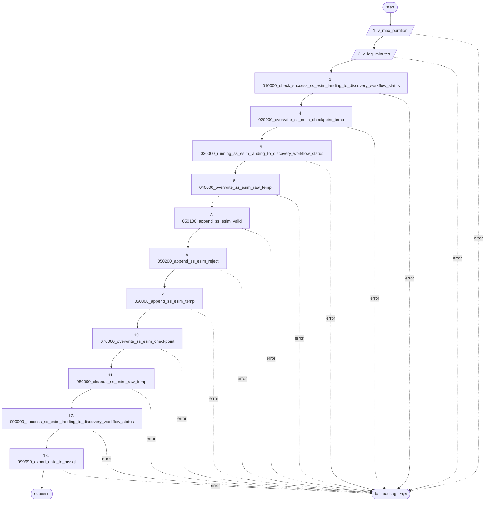

# 03 — ODI Package Flow: PKG_SS_ESIM_L2D

ส่วน AUTO สร้างจาก `output/dml/_manifest.json` + `config/config.json` ด้วย `python scripts/pipeline/gen_design_docs.py`

<!-- AUTO:BEGIN -->
_สร้างโดย gen_design_docs.py 2026-10-29 18:13_

Package: `PKG_SS_ESIM_L2D` · Project: `SS_ESIM_L2D` · Logical schema: `DSS_ODI_LOG` / context `DEV`

| Seq | Type | Step | รายละเอียด | Target / query |
|---|---|---|---|---|
| 1 | Variable | `v_max_partition` | Refresh Variable | SELECT NVL(MAX(partition_minute), 0) FROM <%=odiRef.getSchemaName("DSS_ODI_LOG","D")%>.tb_landing_ss_esim |
| 2 | Variable | `v_lag_minutes` | Refresh Variable | SELECT NVL(ROUND((SYSDATE - TO_DATE(TO_CHAR(MAX(partition_minute)), 'YYYYMMDDHH24MI')) * 1440), 999999) FROM <%=odiRef.getSchemaName("DSS_ODI_LOG","D")%>.tb_landing_ss_esim |
| 3 | Procedure | `010000_check_success_ss_esim_landing_to_discovery_workflow_status` | STEP_1_TRUNCATE, STEP_2_INSERT | DSSDEV.TB_STAGING_SS_ESIM_LANDING_TO_DISCOVERY_WORKFLOW_STATUS_TEMP |
| 4 | Procedure | `020000_overwrite_ss_esim_checkpoint_temp` | STEP_1_DELETE, STEP_2_INSERT | DSSDEV.TB_STAGING_SS_ESIM_CHECKPOINT_TEMP |
| 5 | Procedure | `030000_running_ss_esim_landing_to_discovery_workflow_status` | STEP_1_TRUNCATE, STEP_2_INSERT | DSSDEV.TB_STAGING_SS_ESIM_LANDING_TO_DISCOVERY_WORKFLOW_STATUS |
| 6 | Procedure | `040000_overwrite_ss_esim_raw_temp` | STEP_1_DELETE, STEP_2_INSERT | DSSDEV.TB_STAGING_SS_ESIM_RAW_TEMP |
| 7 | Procedure | `050100_append_ss_esim_valid` | STEP_1_INSERT | DSSDEV.TB_TRANSACTION_SS_ESIM_VALID |
| 8 | Procedure | `050200_append_ss_esim_reject` | STEP_1_INSERT | DSSDEV.TB_TRANSACTION_SS_ESIM_REJECT |
| 9 | Procedure | `050300_append_ss_esim_temp` | STEP_1_INSERT | DSSDEV.TB_TRANSACTION_SS_ESIM_TEMP |
| 10 | Procedure | `070000_overwrite_ss_esim_checkpoint` | STEP_1_DELETE, STEP_2_INSERT | DSSDEV.TB_STAGING_SS_ESIM_CHECKPOINT |
| 11 | Procedure | `080000_cleanup_ss_esim_raw_temp` | STEP_1_DELETE | DSSDEV.TB_STAGING_SS_ESIM_RAW_TEMP |
| 12 | Procedure | `090000_success_ss_esim_landing_to_discovery_workflow_status` | STEP_1_TRUNCATE, STEP_2_INSERT | DSSDEV.TB_STAGING_SS_ESIM_LANDING_TO_DISCOVERY_WORKFLOW_STATUS |
| 13 | Procedure | `999999_export_data_to_mssql` | STEP_1_PLACEHOLDER | - |

<!-- AUTO:END -->

## Error / restart behaviour

| สถานการณ์ | ผล | วิธี restart |
|---|---|---|
| step ใด fail | package หยุด (fail-fast) | แก้สาเหตุ → รัน package ใหม่ทั้งหมด (idempotent?) _(ยืนยัน)_ |
| landing ค้าง | _(ขึ้นกับ Evaluate step — ดู OPEN_DECISIONS)_ | |
